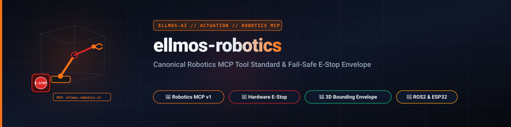
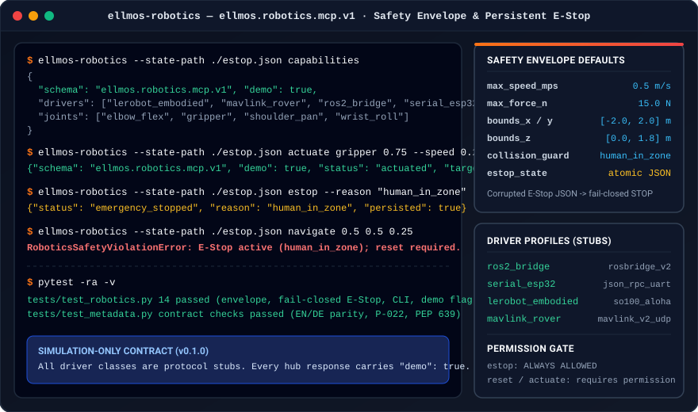
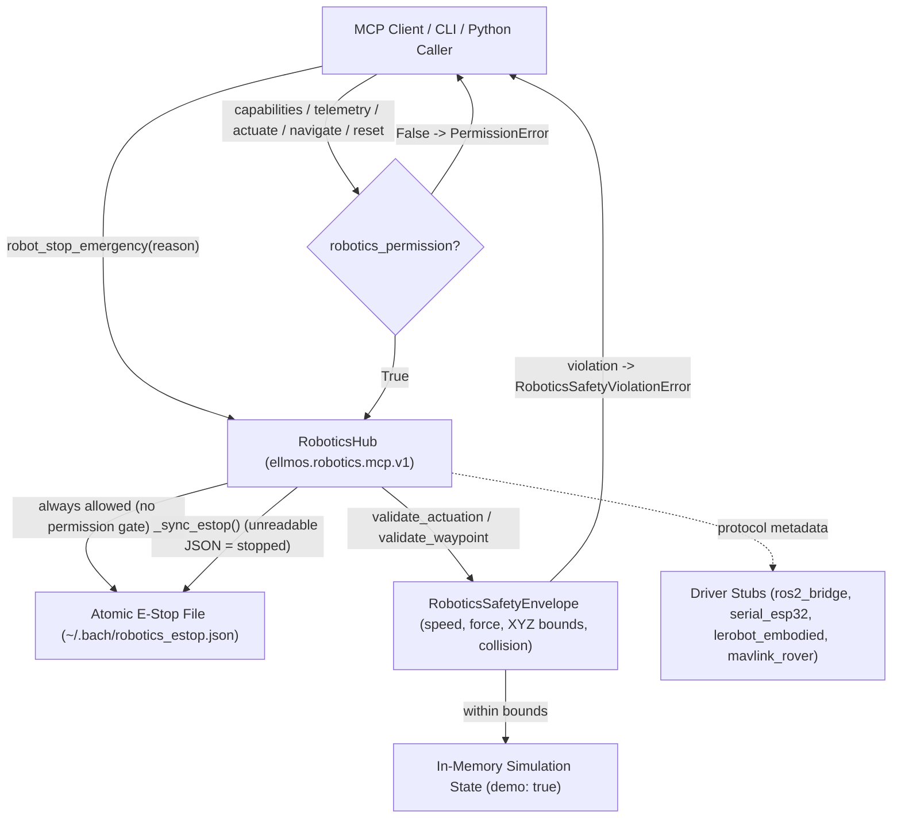
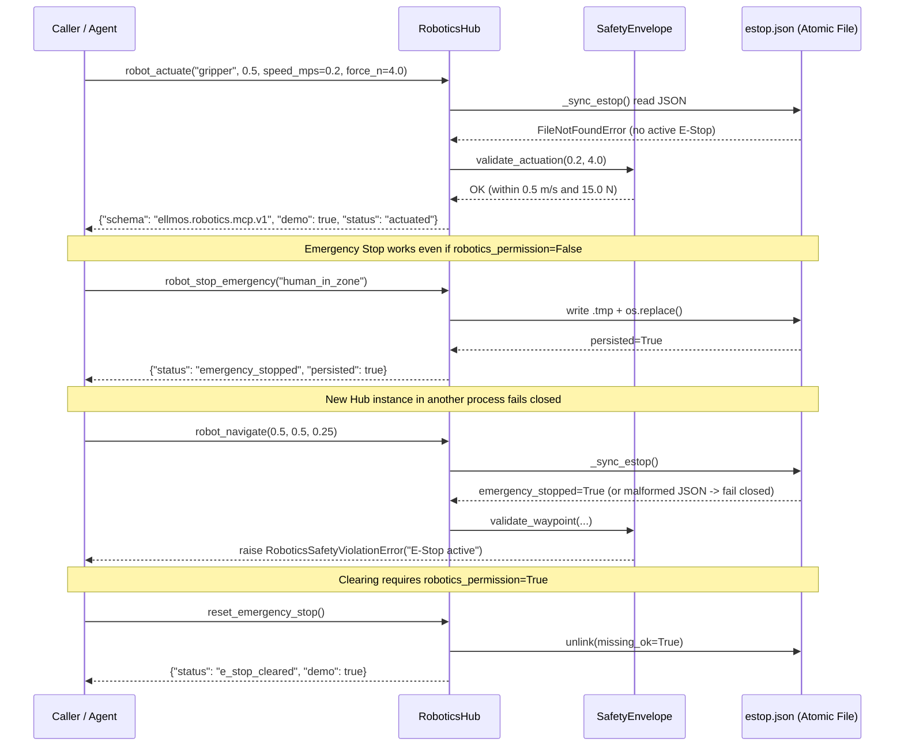

<p align="center">
  
</p>

# ellmos-robotics

**English** | [Deutsch](README_de.md)

[](pyproject.toml)
[](LICENSE)
[-0284c7.svg)](pyproject.toml)
[](ellmos-module.v2.json)
[-f59e0b.svg)](SKILL.md)
[-16a34a.svg)](tests/test_robotics.py)
[](CHANGELOG.md)

Tool standard `ellmos.robotics.mcp.v1` for LLM-to-robot communication in the ellmos ecosystem (**BACH**, **Open Ocean**): a dependency-free Python package providing `RoboticsHub` with five robot tools (plus E-Stop reset), a fail-closed `RoboticsSafetyEnvelope` (speed, force, 3D workspace bounds, collision-zone guard, persistent atomic E-Stop), and protocol driver profiles.

> **Status: early (v0.1.0), simulation only.** The driver classes (`ros2_bridge`, `serial_esp32`, `lerobot_embodied`, `mavlink_rover`) are stubs that carry an id and a protocol name; none of them talks to hardware. All hub results come from simulated in-memory state and are marked `"demo": true`. The safety logic (envelope checks, persistent E-Stop) is real and tested, but this package must not be used to move physical hardware as is.

---

## Navigation

| # | Section | Focus |
|---|---|---|
| 1 | [Terminal Workflow Preview](#sec-01-preview) | CLI commands, fail-closed E-Stop & safety defaults |
| 2 | [Architecture & Safety Envelope](#sec-02-architecture) | Component topology, bounds & driver profile stubs |
| 3 | [Fail-Closed E-Stop Lifecycle](#sec-03-sequence) | Sequence diagram: E-Stop persistence & permission-gated reset |
| 4 | [Tool Surface & Permission Matrix](#sec-04-api) | `RoboticsHub` methods, joints, frames & access rules |
| 5 | [Quickstart (CLI & Python API)](#sec-05-quickstart) | Zero-dependency installation, CLI & Python examples |
| 6 | [Install with your LLM (P-022)](#sec-06-llm) | Copyable agent prompt, [`SKILL.md`](SKILL.md) & [`llms.txt`](llms.txt) |
| 7 | [Use Cases & Ecosystem Relation](#sec-07-ecosystem) | Open Ocean, `ellmos-sensation`, BACH & module manifest |
| 8 | [Repository Structure](#sec-08-structure) | Package, tests, assets & governance files |
| 9 | [Community, Security & License](#sec-09-community) | Contributing, security SLA, MIT license & attribution |

---

<a id="sec-01-preview"></a>
## 1. Terminal Workflow Preview



---

<a id="sec-02-architecture"></a>
## 2. Architecture & Safety Envelope

`RoboticsHub` enforces permission checks, persistent E-Stop synchronization, and physical envelope limits before any simulated joint actuation or 3D waypoint update is accepted.



### Default `RoboticsSafetyEnvelope` Bounds

| Parameter | Default | Violation Behavior |
|---|---|---|
| `max_speed_mps` | `0.5` m/s | Raises `RoboticsSafetyViolationError` |
| `max_force_n` | `15.0` N | Raises `RoboticsSafetyViolationError` |
| `bounds_x` / `bounds_y` | `(-2.0, 2.0)` m | Raises `RoboticsSafetyViolationError` |
| `bounds_z` | `(0.0, 1.8)` m | Raises `RoboticsSafetyViolationError` |
| `emergency_stopped` | `False` (or persisted) | Blocks actuation & navigation until reset |
| `human_in_collision_zone` | `False` | Blocks actuation & navigation (`ellmos-sensation` guard) |

### Driver Profiles (Simulation Stubs)

| Driver ID (`driver_id`) | Protocol (`protocol`) | Class | Hardware I/O |
|---|---|---|---|
| `ros2_bridge` | `rosbridge_v2_websocket` | `Ros2BridgeDriver` | Stub only (`demo: true`) |
| `serial_esp32` | `json_rpc_uart_wifi` | `SerialEsp32Driver` | Stub only (`demo: true`) |
| `lerobot_embodied` | `lerobot_so100_aloha` | `LeRobotDriver` | Stub only (`demo: true`) |
| `mavlink_rover` | `mavlink_v2_udp` | `MavlinkDroneDriver` | Stub only (`demo: true`) |

---

<a id="sec-03-sequence"></a>
## 3. Fail-Closed E-Stop & Actuation Lifecycle

Every new `RoboticsHub` instance checks the persisted E-Stop state file before reading capabilities, telemetry, or executing motion. An unreadable or corrupted JSON file fails closed as actively stopped.



---

<a id="sec-04-api"></a>
## 4. Tool Surface & Permission Matrix

- **`RoboticsHub`** (`src/ellmos_robotics/mcp_standard.py`):
  - `robot_capabilities()`: drivers, joints (`shoulder_pan`, `elbow_flex`, `wrist_roll`, `gripper`), coordinate frames (`base_link`, `map`, `end_effector`), current safety envelope.
  - `robot_telemetry()`: simulated position, joint values, battery (`94.0%`), E-Stop and collision-zone flags, UTC timestamp.
  - `robot_actuate(joint_or_axis, target_value, *, speed_mps=0.2, force_n=5.0)`: validates known joint + envelope before updating joint value.
  - `robot_navigate(x, y, z=0.25, *, speed_mps=0.25, frame_id="base_link")`: validates waypoint + speed before updating simulated pose.
  - `robot_stop_emergency(reason="operator_e_stop")`: **always allowed**, even with `robotics_permission=False`.
  - `reset_emergency_stop()`: requires `robotics_permission=True`.
- **Persistent E-Stop path resolution (`default_estop_path()`):** Uses `--state-path` / `state_path` if provided, otherwise `BACH_ROBOTICS_ESTOP_PATH`, otherwise `~/.bach/robotics_estop.json`.

| Method | `robotics_permission=False` | Active E-Stop | `human_in_collision_zone=True` |
|---|---|---|---|
| `robot_capabilities()` | `PermissionError` | Allowed (`emergency_stopped: true` in envelope) | Allowed |
| `robot_telemetry()` | `PermissionError` | Allowed (`emergency_stopped: true`) | Allowed |
| `robot_actuate(...)` | `PermissionError` | `RoboticsSafetyViolationError` | `RoboticsSafetyViolationError` |
| `robot_navigate(...)` | `PermissionError` | `RoboticsSafetyViolationError` | `RoboticsSafetyViolationError` |
| `robot_stop_emergency(...)` | **Allowed** | Allowed (updates persisted state) | **Allowed** |
| `reset_emergency_stop()` | `PermissionError` | Allowed (if permitted) | Clears E-Stop flag only |

---

<a id="sec-05-quickstart"></a>
## 5. Quickstart (CLI & Python API)

Requires Python **3.10 or newer**; there are **zero runtime dependencies**.

```bash
git clone https://github.com/ellmos-ai/ellmos-robotics.git
cd ellmos-robotics
python -m venv .venv
# Windows: .venv\Scripts\activate
# Linux / macOS: source .venv/bin/activate
pip install -e .
pip install -e ".[dev]"   # pytest
```

### CLI Usage

```bash
ellmos-robotics --state-path ./estop.json capabilities
ellmos-robotics --state-path ./estop.json telemetry
ellmos-robotics --state-path ./estop.json actuate gripper 0.5 --speed 0.2 --force 5
ellmos-robotics --state-path ./estop.json navigate 0.5 0.5 0.25
ellmos-robotics --state-path ./estop.json estop --reason "test"
ellmos-robotics --state-path ./estop.json telemetry
```

### Python API

```python
from ellmos_robotics.mcp_standard import RoboticsHub

hub = RoboticsHub(state_path="estop.json")
hub.robot_navigate(0.5, 0.5)
hub.robot_stop_emergency("operator")
# any later robot_actuate / robot_navigate now raises RoboticsSafetyViolationError
```

Note that `ellmos-robotics estop` writes the E-Stop file; reset it from Python with `reset_emergency_stop()` or by deleting the temporary state file.

---

<a id="sec-06-llm"></a>
## 6. Install with your LLM (P-022)

This repository ships machine-readable product entry points according to Policy **P-022**:

- Product Skill: [`SKILL.md`](SKILL.md)
- Canonical LLM Entry: [`llms.txt`](llms.txt)
- Compatibility Pointer: [`llm.txt`](llm.txt)

Copy this prompt into your AI coding assistant to install and verify `ellmos-robotics` safely in an isolated `.venv`:

```text
Install https://github.com/ellmos-ai/ellmos-robotics in a local .venv, read SKILL.md and llms.txt first, keep version 0.1.0 unchanged, run pytest -ra -v, and verify `ellmos-robotics --state-path ./tmp_estop.json capabilities` returns schema `ellmos.robotics.mcp.v1` and `"demo": true`. Do not modify `~/.bach/robotics_estop.json`.
```

---

<a id="sec-07-ecosystem"></a>
## 7. Use Cases & Ecosystem Relation

- **MCP Tool Prototyping:** Validate agent-to-robot JSON schemas (`ellmos.robotics.mcp.v1`) without attached hardware.
- **Safety Guardrail Testing:** Verify speed, force, workspace bounds, and cross-process E-Stop persistence in CI.
- **Ecosystem Integration:** Listed in the [Open Ocean](https://github.com/ellmos-ai/open-ocean) module map. The `human_in_collision_zone` envelope flag is designed to receive safety triggers from [ellmos-sensation](https://github.com/ellmos-ai/ellmos-sensation) (coupling not implemented in this repository). Module metadata lives in [`ellmos-module.v2.json`](ellmos-module.v2.json).

---

<a id="sec-08-structure"></a>
## 8. Repository Structure

```text
ellmos-robotics/
├── .github/ISSUE_TEMPLATE/   # Bug report & feature request templates
├── assets/
│   ├── banner.svg / .png     # Repository header banner
│   └── terminal-workflow.svg # Dark-mode CLI & safety envelope preview
├── src/ellmos_robotics/
│   ├── __init__.py           # Public exports & __version__ ("0.1.0")
│   ├── mcp_standard.py       # RoboticsHub, RoboticsSafetyEnvelope, driver stubs
│   └── cli.py                # `ellmos-robotics` CLI entrypoint
├── tests/
│   ├── test_robotics.py      # Functional, envelope & E-Stop persistence tests (14)
│   └── test_metadata.py      # README parity, P-022 & metadata contract tests (6)
├── CHANGELOG.md              # Release history & [Unreleased] notes
├── CODE_OF_CONDUCT.md        # Bilingual Contributor Covenant (EN/DE)
├── CONTRIBUTING.md           # Bilingual contribution & safety rules (EN/DE)
├── LICENSE                   # MIT License
├── SECURITY.md               # Fail-closed safety boundary & 48h vulnerability SLA
├── SKILL.md                  # P-022 standalone product skill
├── llms.txt / llm.txt        # P-022 LLM entry point & compatibility pointer
├── ellmos-module.v2.json     # Open Ocean / BACH module descriptor
└── pyproject.toml            # PEP 621 / PEP 639 package configuration
```

---

<a id="sec-09-community"></a>
## 9. Community, Security & License

- **License:** [MIT License](LICENSE), as declared in [`pyproject.toml`](pyproject.toml).
- **Contributing & Conduct:** See [`CONTRIBUTING.md`](CONTRIBUTING.md) and [`CODE_OF_CONDUCT.md`](CODE_OF_CONDUCT.md).
- **Security:** Report safety-bypass or E-Stop flaws privately per [`SECURITY.md`](SECURITY.md) (48h initial response SLA).

---

> Concept & Approval: Geiger · Text assistance: LLM-assisted · Graphics: SVG-generated
