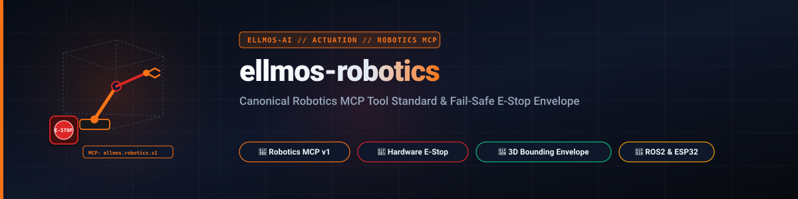
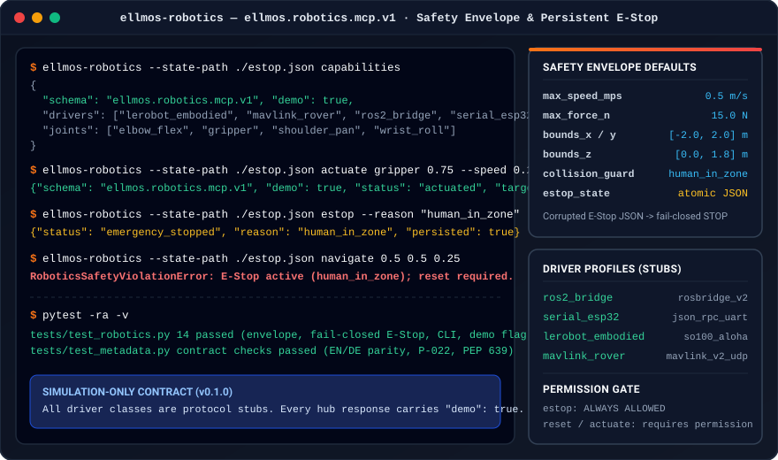
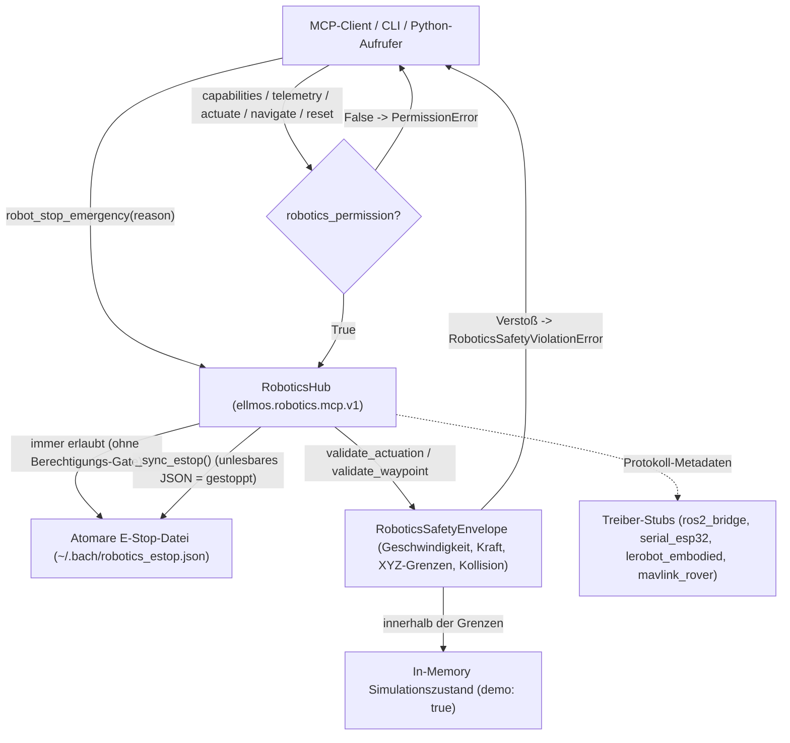
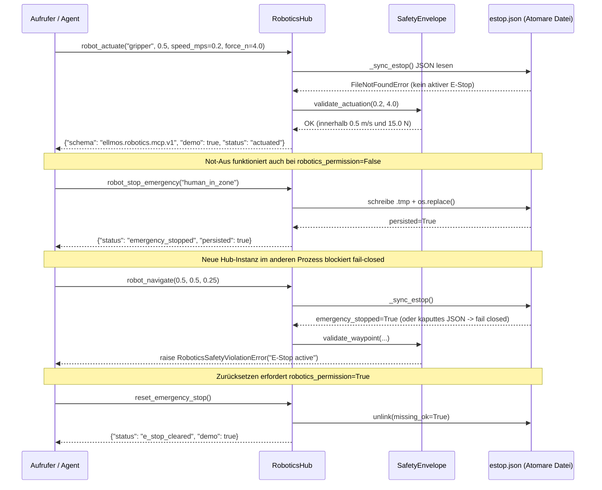

<p align="center">
  
</p>

# ellmos-robotics

[English](README.md) | **Deutsch**

[](pyproject.toml)
[](LICENSE)
[-0284c7.svg)](pyproject.toml)
[](ellmos-module.v2.json)
[-f59e0b.svg)](SKILL.md)
[-16a34a.svg)](tests/test_robotics.py)
[](CHANGELOG.md)

Werkzeugstandard `ellmos.robotics.mcp.v1` für die Kommunikation von LLMs mit Robotern im ellmos-Ökosystem (**BACH**, **Open Ocean**): ein abhängigkeitsfreies Python-Paket mit dem `RoboticsHub` (fünf Roboter-Werkzeuge plus E-Stop-Reset), einer fail-closed `RoboticsSafetyEnvelope` (Geschwindigkeit, Kraft, 3D-Arbeitsraumgrenzen, Kollisionszonen-Wächter, persistenter atomarer E-Stop) und Protokoll-Treiberprofilen.

> **Status: early (v0.1.0), nur Simulation.** Die Treiberklassen (`ros2_bridge`, `serial_esp32`, `lerobot_embodied`, `mavlink_rover`) sind Stubs mit Kennung und Protokollname; keine davon spricht mit Hardware. Alle Hub-Ergebnisse stammen aus simuliertem Speicherzustand und tragen `"demo": true`. Die Sicherheitslogik (Hüllenprüfung, persistenter E-Stop) ist echt und getestet, das Paket darf in diesem Zustand aber nicht zur Bewegung physischer Hardware verwendet werden.

---

## Navigation

| # | Abschnitt | Schwerpunkt |
|---|---|---|
| 1 | [Terminal-Workflow-Vorschau](#sec-01-preview) | CLI-Aufrufe, fail-closed E-Stop & Sicherheits-Defaults |
| 2 | [Architektur & Sicherheitshülle](#sec-02-architecture) | Komponententopologie, Grenzwerte & Treiber-Stubs |
| 3 | [Fail-Closed E-Stop-Lebenszyklus](#sec-03-sequence) | Sequenzdiagramm: E-Stop-Persistenz & geschützter Reset |
| 4 | [Werkzeugoberfläche & Berechtigungsmatrix](#sec-04-api) | `RoboticsHub`-Methoden, Gelenke, Frames & Zugriffsregeln |
| 5 | [Schnellstart (CLI & Python-API)](#sec-05-quickstart) | Abhängigkeitsfreie Installation, CLI- & Python-Beispiele |
| 6 | [Mit deinem LLM installieren (P-022)](#sec-06-llm) | Kopierbarer Agenten-Prompt, [`SKILL.md`](SKILL.md) & [`llms.txt`](llms.txt) |
| 7 | [Einsatzszenarien & Ökosystem-Bezug](#sec-07-ecosystem) | Open Ocean, `ellmos-sensation`, BACH & Modul-Manifest |
| 8 | [Repository-Struktur](#sec-08-structure) | Paket, Tests, Assets & Governance-Dateien |
| 9 | [Community, Sicherheit & Lizenz](#sec-09-community) | Mitwirken, Sicherheits-SLA, MIT-Lizenz & Kennzeichnung |

---

<a id="sec-01-preview"></a>
## 1. Terminal-Workflow-Vorschau



---

<a id="sec-02-architecture"></a>
## 2. Architektur & Sicherheitshülle

`RoboticsHub` erzwingt Berechtigungsprüfungen, persistente E-Stop-Synchronisation und physikalische Hüllengrenzen, bevor eine simulierte Gelenkbewegung oder 3D-Wegpunktänderung akzeptiert wird.



### Standardwerte der `RoboticsSafetyEnvelope`

| Parameter | Standardwert | Verhalten bei Überschreitung |
|---|---|---|
| `max_speed_mps` | `0.5` m/s | Löst `RoboticsSafetyViolationError` aus |
| `max_force_n` | `15.0` N | Löst `RoboticsSafetyViolationError` aus |
| `bounds_x` / `bounds_y` | `(-2.0, 2.0)` m | Löst `RoboticsSafetyViolationError` aus |
| `bounds_z` | `(0.0, 1.8)` m | Löst `RoboticsSafetyViolationError` aus |
| `emergency_stopped` | `False` (oder persistiert) | Blockiert Aktorik & Navigation bis zum Reset |
| `human_in_collision_zone` | `False` | Blockiert Aktorik & Navigation (`ellmos-sensation`-Schutz) |

### Treiberprofile (Simulations-Stubs)

| Treiber-ID (`driver_id`) | Protokoll (`protocol`) | Klasse | Hardware-I/O |
|---|---|---|---|
| `ros2_bridge` | `rosbridge_v2_websocket` | `Ros2BridgeDriver` | Nur Stub (`demo: true`) |
| `serial_esp32` | `json_rpc_uart_wifi` | `SerialEsp32Driver` | Nur Stub (`demo: true`) |
| `lerobot_embodied` | `lerobot_so100_aloha` | `LeRobotDriver` | Nur Stub (`demo: true`) |
| `mavlink_rover` | `mavlink_v2_udp` | `MavlinkDroneDriver` | Nur Stub (`demo: true`) |

---

<a id="sec-03-sequence"></a>
## 3. Fail-Closed E-Stop-Lebenszyklus

Jede neue `RoboticsHub`-Instanz prüft vor Capabilities-, Telemetrie- oder Bewegungsaufrufen die persistierte E-Stop-Zustandsdatei. Eine unlesbare oder beschädigte JSON-Datei gilt fail-closed als aktiv gestoppt.



---

<a id="sec-04-api"></a>
## 4. Werkzeugoberfläche & Berechtigungsmatrix

- **`RoboticsHub`** (`src/ellmos_robotics/mcp_standard.py`):
  - `robot_capabilities()`: Treiber, Gelenke (`shoulder_pan`, `elbow_flex`, `wrist_roll`, `gripper`), Koordinatenrahmen (`base_link`, `map`, `end_effector`), aktuelle Sicherheitshülle.
  - `robot_telemetry()`: simulierte Position, Gelenkwerte, Batterie (`94.0%`), E-Stop- und Kollisionszonen-Flags, UTC-Zeitstempel.
  - `robot_actuate(joint_or_axis, target_value, *, speed_mps=0.2, force_n=5.0)`: prüft Gelenknamen und Sicherheitshülle vor Aktualisierung des Gelenkwerts.
  - `robot_navigate(x, y, z=0.25, *, speed_mps=0.25, frame_id="base_link")`: prüft Wegpunkt und Geschwindigkeit vor Aktualisierung der simulierten Position.
  - `robot_stop_emergency(reason="operator_e_stop")`: **immer erlaubt**, auch ohne Robotik-Berechtigung (`robotics_permission=False`).
  - `reset_emergency_stop()`: erfordert Robotik-Berechtigung (`robotics_permission=True`).
- **Auflösung des E-Stop-Pfads (`default_estop_path()`):** Nutzt `--state-path` bzw. `state_path`, sonst `BACH_ROBOTICS_ESTOP_PATH`, sonst `~/.bach/robotics_estop.json`.

| Methode | `robotics_permission=False` | Aktiver E-Stop | `human_in_collision_zone=True` |
|---|---|---|---|
| `robot_capabilities()` | `PermissionError` | Erlaubt (`emergency_stopped: true` in Hülle) | Erlaubt |
| `robot_telemetry()` | `PermissionError` | Erlaubt (`emergency_stopped: true`) | Erlaubt |
| `robot_actuate(...)` | `PermissionError` | `RoboticsSafetyViolationError` | `RoboticsSafetyViolationError` |
| `robot_navigate(...)` | `PermissionError` | `RoboticsSafetyViolationError` | `RoboticsSafetyViolationError` |
| `robot_stop_emergency(...)` | **Erlaubt** | Erlaubt (aktualisiert persistierten Zustand) | **Erlaubt** |
| `reset_emergency_stop()` | `PermissionError` | Erlaubt (mit Berechtigung) | Löscht nur E-Stop-Flag |

---

<a id="sec-05-quickstart"></a>
## 5. Schnellstart (CLI & Python-API)

Benötigt Python **3.10 oder neuer**; es gibt **keine Laufzeitabhängigkeiten**.

```bash
git clone https://github.com/ellmos-ai/ellmos-robotics.git
cd ellmos-robotics
python -m venv .venv
# Windows: .venv\Scripts\activate
# Linux / macOS: source .venv/bin/activate
pip install -e .
pip install -e ".[dev]"   # pytest
```

### Nutzung über die CLI

```bash
ellmos-robotics --state-path ./estop.json capabilities
ellmos-robotics --state-path ./estop.json telemetry
ellmos-robotics --state-path ./estop.json actuate gripper 0.5 --speed 0.2 --force 5
ellmos-robotics --state-path ./estop.json navigate 0.5 0.5 0.25
ellmos-robotics --state-path ./estop.json estop --reason "test"
ellmos-robotics --state-path ./estop.json telemetry
```

### Nutzung in Python

```python
from ellmos_robotics.mcp_standard import RoboticsHub

hub = RoboticsHub(state_path="estop.json")
hub.robot_navigate(0.5, 0.5)
hub.robot_stop_emergency("operator")
# jedes weitere robot_actuate / robot_navigate löst nun RoboticsSafetyViolationError aus
```

Hinweis: Der CLI-Befehl `estop` schreibt die E-Stop-Datei; zurückgesetzt wird sie in Python mit `reset_emergency_stop()` oder durch Löschen der temporären Zustandsdatei.

---

<a id="sec-06-llm"></a>
## 6. Mit deinem LLM installieren (P-022)

Dieses Repository liefert maschinenlesbare Einstiegspunkte gemäß Policy **P-022** mit:

- Produkt-Skill: [`SKILL.md`](SKILL.md)
- Kanonischer LLM-Einstieg: [`llms.txt`](llms.txt)
- Kompatibilitätsverweis: [`llm.txt`](llm.txt)

Kopiere diesen Prompt in deinen KI-Programmierassistenten, um `ellmos-robotics` sicher in einer isolierten `.venv` zu installieren und zu prüfen:

```text
Installiere https://github.com/ellmos-ai/ellmos-robotics in einer lokalen .venv, lies zuerst SKILL.md und llms.txt, belasse Version 0.1.0 unverändert, führe `pytest -ra -v` aus und verifiziere, dass `ellmos-robotics --state-path ./tmp_estop.json capabilities` das Schema `ellmos.robotics.mcp.v1` und `"demo": true` zurückgibt. Verändere dabei nicht `~/.bach/robotics_estop.json`.
```

---

<a id="sec-07-ecosystem"></a>
## 7. Einsatzszenarien & Ökosystem-Bezug

- **MCP-Werkzeug-Prototyping:** Agenten-zu-Roboter-JSON-Schemas (`ellmos.robotics.mcp.v1`) ohne angeschlossene Hardware validieren.
- **Schutzgrenzen-Tests:** Geschwindigkeits-, Kraft-, Arbeitsraumgrenzen und prozessübergreifende E-Stop-Persistenz in CI prüfen.
- **Ökosystem-Einbindung:** Aufgeführt in der Modulzuordnung von [Open Ocean](https://github.com/ellmos-ai/open-ocean). Die Hülle enthält das Flag `human_in_collision_zone`, das von [ellmos-sensation](https://github.com/ellmos-ai/ellmos-sensation) gespeist werden soll (diese Kopplung ist in diesem Repository nicht umgesetzt). Die Modul-Metadaten stehen in [`ellmos-module.v2.json`](ellmos-module.v2.json).

---

<a id="sec-08-structure"></a>
## 8. Repository-Struktur

```text
ellmos-robotics/
├── .github/ISSUE_TEMPLATE/   # Fehlerbericht- & Funktionswunsch-Vorlagen
├── assets/
│   ├── banner.svg / .png     # Repository-Header-Banner
│   └── terminal-workflow.svg # Dark-Mode CLI- & Sicherheitshüllen-Vorschau
├── src/ellmos_robotics/
│   ├── __init__.py           # Öffentliche Exporte & __version__ ("0.1.0")
│   ├── mcp_standard.py       # RoboticsHub, RoboticsSafetyEnvelope, Treiber-Stubs
│   └── cli.py                # `ellmos-robotics` CLI-Einstiegspunkt
├── tests/
│   ├── test_robotics.py      # Funktions-, Hüllen- & E-Stop-Persistenztests (14)
│   └── test_metadata.py      # README-Parität, P-022 & Metadaten-Vertragstests (6)
├── CHANGELOG.md              # Versionshistorie & [Unreleased]-Einträge
├── CODE_OF_CONDUCT.md        # Zweisprachiger Verhaltenskodex (EN/DE)
├── CONTRIBUTING.md           # Zweisprachige Beitrags- & Sicherheitsregeln (EN/DE)
├── LICENSE                   # MIT-Lizenz
├── SECURITY.md               # Fail-Closed-Sicherheitsgrenze & 48h-Melde-SLA
├── SKILL.md                  # Eigenständiger Produkt-Skill (P-022)
├── llms.txt / llm.txt        # LLM-Einstiegspunkt & Kompatibilitätsverweis (P-022)
├── ellmos-module.v2.json     # Open-Ocean- / BACH-Moduldeskriptor
└── pyproject.toml            # PEP-621- / PEP-639-Paketkonfiguration
```

---

<a id="sec-09-community"></a>
## 9. Community, Sicherheit & Lizenz

- **Lizenz:** [MIT-Lizenz](LICENSE), wie in [`pyproject.toml`](pyproject.toml) angegeben.
- **Mitwirken & Verhaltenskodex:** Siehe [`CONTRIBUTING.md`](CONTRIBUTING.md) und [`CODE_OF_CONDUCT.md`](CODE_OF_CONDUCT.md).
- **Sicherheit:** Sicherheits- oder E-Stop-Umgehungsfehler bitte vertraulich gemäß [`SECURITY.md`](SECURITY.md) melden (48h-Erstreaktions-SLA).

---

> Idee & Abnahme: Geiger · Textassistenz: LLM-gestützt · Grafik: SVG-generiert
